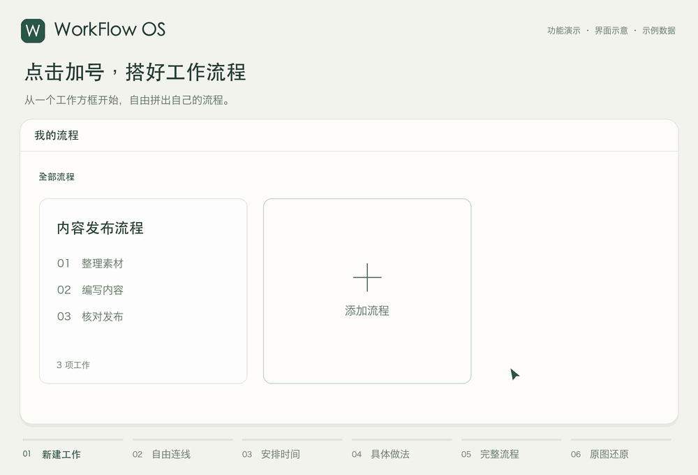
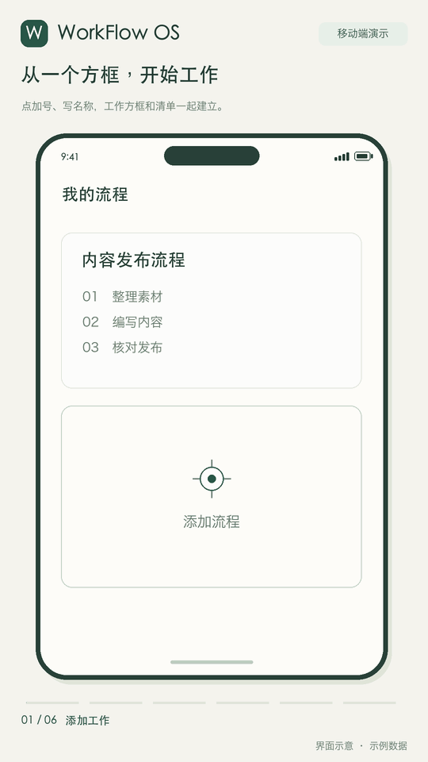

# WorkFlow OS

用于记录工作流程和每件事具体做法的工作空间。React / TypeScript / Vite 前端，Java 21 / Spring Boot 3.5 后端，PostgreSQL 部署方案；本地开发可使用持久化 H2。

## 下载与使用

[打开统一下载页](https://ioi610.github.io/workflow-os/) · [GitHub 安装包与 GIF](https://github.com/ioi610/workflow-os/releases/tag/v0.2.0) · [直接使用网页版](https://ioi610.github.io/workflow-os/app/)

| 设备 | 下载 |
| --- | --- |
| Windows x64 | [安装包 EXE](https://github.com/ioi610/workflow-os/releases/download/v0.2.0/WorkFlow-OS-Windows-x64.exe) |
| Mac Apple Silicon · macOS 13+ | [DMG](https://github.com/ioi610/workflow-os/releases/download/v0.2.0/WorkFlow-OS-macOS-arm64.dmg) · [ZIP](https://github.com/ioi610/workflow-os/releases/download/v0.2.0/WorkFlow-OS-macOS-arm64.zip) |
| Mac Intel · macOS 13+ | [DMG](https://github.com/ioi610/workflow-os/releases/download/v0.2.0/WorkFlow-OS-macOS-x64.dmg) · [ZIP](https://github.com/ioi610/workflow-os/releases/download/v0.2.0/WorkFlow-OS-macOS-x64.zip) |
| Linux x64 | [AppImage](https://github.com/ioi610/workflow-os/releases/download/v0.2.0/WorkFlow-OS-Linux-x64.AppImage) · [tar.gz](https://github.com/ioi610/workflow-os/releases/download/v0.2.0/WorkFlow-OS-Linux-x64.tar.gz) |
| Android 7+ · WebView 107+ | [签名 APK](https://github.com/ioi610/workflow-os/releases/download/v0.2.0/WorkFlow-OS-Android.apk) |
| iPhone / iPad | [Safari 打开](https://ioi610.github.io/workflow-os/app/)，分享 → 添加到主屏幕（PWA，当前没有 IPA） |

安装版无需后端、登录或 API 密钥，自动保存在本机；网页版首次联网加载完成后可离线使用。不同设备分别保存，不会自动同步。原来 Java 服务端的内容不会自动导入；可用「复制全文」及「文字生成流程图」搬入框架和文字，旧服务器图片需重新添加。清除应用/网站数据会清掉本机内容，请备份重要流程。

电脑安装包尚无 Apple / Windows 开发者证书签名或公证，首次运行可能需系统确认来源。[SHA-256 校验文件](https://github.com/ioi610/workflow-os/releases/download/v0.2.0/SHA256SUMS.txt) · [桌面构建说明](docs/desktop-build.md) · [Android 构建说明](docs/android-build.md)

## 功能演示

26 秒循环演示添加工作、拖动连线、时间调整、具体做法、完整流程和原图还原。动画使用示例数据制作，为界面示意。



[下载电脑 GIF](https://github.com/ioi610/workflow-os/releases/download/v0.2.0/workflow-os-demo.gif) · [静态预览](docs/demo/workflow-os-demo-poster.png)

手机端：



[下载手机 GIF](https://github.com/ioi610/workflow-os/releases/download/v0.2.0/workflow-os-mobile-demo.gif) · [静态预览](docs/demo/workflow-os-mobile-demo-poster.png)

首页把流程和工作清单放在一起。用一个个工作方框拼出自己的流程，用箭头表示先做什么、后做什么；点击工作名称，查看自己写的具体做法。工作清单会自动列出流程里的每项工作。界面不提供今日任务、完成状态、关注提醒或统计。最初的完整规格保存在 [docs/requirements.md](docs/requirements.md)，仅供查看历史设计。

## 当前功能

- 使用暖纸白与深森林绿主题，统一卡片、加号、表单、流程图、工作清单和弹窗的样式。
- 本机自用时打开即用，不用注册或登录。之前保存的内容会继续保留；有多份工作内容时，在首页分类旁用「切换工作内容」选择。
- 点击带加号和「添加流程」文字的方框，新建自己的流程。可以按分类查看流程，首页没有多余导航或介绍。
- 在空白流程图中点击加号，填写工作名称，或从工作清单选择已经有的工作。工作方框的初始宽、高各为原始流程图的五分之一；流程图不划分格子，可以自由摆放。拖动方框右下角可分别改变宽、高，拉成自己需要的长方形，手机也能操作。
- 用「− / ＋」或拖动整张图右下角，可以把流程图整体放大、缩小；文字、工作方框、箭头和坐标轴一起缩放。默认显示为 100%，更换屏幕大小不会自动改变比例。缩放只记在本机，各流程分别保留，不改变工作数据；放大后可在画板区域内滚动查看，手机也支持。
- 点「模版大小」可分别输入 320–2400 像素的宽度和高度，调整流程图的空白范围，已有工作方框的位置和大小保持不变。范围不能小于现有工作的边界；已有流程会自动保存，新建流程随「添加流程」一起创建。
- 「安排工作」用来添加和摆放工作，「写具体做法」用来逐条写出怎么做。具体做法可以附上图片和视频。
- 工作与做法首次按名称对应，成功选择后固定做法编号；做法改名仍能打开原内容，不会换成其他同名做法。点击工作方框上的小铅笔可以改名，工作清单会一起更新。本流程对应的做法也会改名并保留内容；引用其他流程的做法时保留原链接，不修改共享来源。编号、方框位置大小和箭头保持不变，取消或按 Esc 不保存。
- 按住工作左上角拖动，把它放到所需位置。画箭头时，可从工作上、右、下、左任一边的小圆点拖到另一项工作；拖到方框会自动选择入边，拖到目标圆点则固定从那一边进入。也可点圆点再点目标，支持键盘操作。点同一工作的另一边可切换起点，点原圆点、空白处或按 Esc 取消。移动工作也能用空格键选中，再用方向键移动。
- 点「整理位置」可先比较整理前后的布局，再点「应用整理」一次保存；取消不修改原图。整理会保留时间、优先级、方框大小、文字和箭头，尽量减少重叠；受时间或空间限制、放不下的工作保留原位，并在预览中列出。
- 首页及流程页面的「文字生成流程图」是本机免费版，不需要密钥或充值，生成预览不发送网络请求。可粘贴最多 16000 个字，按编号、段落、顺序词或箭头拆成 1–60 项工作，自动排好方框并按阅读顺序连线；推荐使用「工作名称：具体做法」的统一格式，所有原文片段保留在做法中。条件、并行和返工等复杂内容会提示检查，不推断分支连线。核对后可改流程名称，再点「添加为新流程」，原流程保留；重复添加同一份预览不会生成多份。生成图默认关闭坐标轴，时间等原文继续保留在做法中，之后可自行安排。
- 需要安排时间或优先级时，点流程图旁的「时间和优先级」，分别开启并选择横轴或纵轴；更改一项方向，另一项会自动互换。默认时间横向、优先级纵向，也可以反过来，单独显示一项时同样能选方向。起止时间可以跨过午夜；时间和优先级按方框可移动的范围计算：贴到左边或上边对应起点，贴到右边或下边对应结束时间或「可以稍后」，大方框也能到达两端。中间位置按剩余移动距离换算，调整方框大小后会重新计算；完全铺满画板、不能移动时按起点显示。两条轴都能单独关闭，旧流程默认不显示。
- 时间线显示每个整点刻度，首尾不足一小时也会保留，不再按屏幕大小省略小时。直接拖动中间刻度可改变左右两段的长度，拖动最后一个刻度可加长或缩短最后一段；也能在「时间和优先级」→「每段时间的长度」中逐段输入像素长度。单独加长一段时，模版的时间轴跟着变长，其他时段的长度保持不变；每段至少 24 像素，时间轴总长为 320–2400 像素。横向、纵向、跨午夜、手机和整体缩放后均可调整，密集的横向标签会旋转显示。调整时保留工作的时间、优先级、方框大小、箭头、编号和具体做法；松开刻度后自动保存，弹窗里点「应用」保存，按 Esc 可取消拖动。刻度可用方向键调整 8 像素，按住 Shift 时调整 1 像素。旧的局部拉宽配置继续读取，修改长度时转换为逐段设置。
- 已有流程编辑中可以修改流程名称、分类和具体做法；停下输入 700 毫秒后自动保存，保存状态显示在「返回流程」旁。做法还没起名、步骤还没写完也能保存，不会挡住其他已写内容。已有流程的修改保存为草稿，不会为每次输入发布一份历史版本。新加工作、拖动位置、调整大小、箭头和媒体修改也会自动保存。方框改大小时，箭头会跟着调整；拖动调整时，按 Esc 可以取消。
- 新流程填写好后，点击「添加流程」创建；填写过程中自动保留本机草稿，刷新后可继续，但不会提前创建流程。各标签页分别保存自己的草稿，关闭旧页面不会清掉另一页的修改；成功创建或保存后只清理本页使用的那份快照。已有流程仍然自动保存。
- 「工作清单」每行显示一项工作，列名是工作名称、编号、所属流程、具体做法和操作。可以搜索工作名称、流程名称或编号，也能选择只看某个流程；点「在流程里查看」找到对应的工作方框。
- 流程卡片、工作方框和工作清单行都有小垃圾桶。删除流程会先确认；如果其他流程还在使用其中的做法，会列出受影响的工作并阻止删除。直接移除被引用的做法也受到保护；没有引用时才一并删除流程中的工作和做法。从清单删除工作也会先确认，并同步移除流程图里的方框和相连箭头，已经写好的具体做法会保留。
- 点击工作名称，只打开这项工作的具体做法，不显示其他工作的内容或切换列表。还没有写过时会直接打开该工作的空白表单；已有做法可点「修改具体做法」，也只编辑这一项，返回后再选择其他工作。先找当前流程里的做法，再找其他流程中唯一的一份；如果有几份名称相同的做法，需要自己选择。英文大小写也要一样，两头的空格不影响。
- 框架搭好后，点「生成完整流程」，把工作名称和自己写的做法整理为连贯正文，相邻做法通过标点接成完整句子和自然段。已安排时间的工作会在前面带上对应时刻（跨午夜显示「次日」），没有设置时间时不补写时间。不添加自动编号、优先级、来源、提示或待补说明，也不补写未知操作。正文保留说明和逐条写下的做法，不再带入旧的准备、注意事项字段；未填写做法时只保留工作名称。点「调整衔接顺序」可调整允许换序的工作，本机会记住选择；正文、「复制全文」与「打印」共用同一份文字和顺序。没有冲突的本机新增做法也会带入，可以点「保存本机做法」安全补存。本机稿与已保存做法不同时，默认使用已保存内容；可在正文外明确切换查看本机稿，提示不进入复制或打印。查看或调序不会修改原流程图、做法、历史和工作清单。
- 可以先添加工作，以后再写做法；也能先写做法，以后再安排到流程里。出现同名工作或同名做法时，会提醒换个名称。
- 保存时会检查内容是否已被改过，避免覆盖较新的内容。原来的保存记录继续保留。
- OWNER / MANAGER 可以修改，EMPLOYEE 只能查看；后端继续检查权限。
- 电脑和手机均可使用；保留 PWA 安装所需文件。

旧的任务、计划和交接接口及历史数据继续保留，当前界面没有这些入口。个人身份、流程、图片和工作清单仍保存在原有数据库与媒体目录中，本次改名不需要重新录入内容。

在「生成完整流程」中点「复制全文」，会一次复制完整正文和还原原图所需的数据。将复制的整段内容粘贴到「文字生成流程图」，即可保留复制时的全部工作、做法、位置、大小、箭头选边、画板和时间/优先级配置，跨浏览器、跨设备也能还原，不按段落重新拆成少量工作。剪贴板不可用时，备用框提供相同的完整内容供手动复制。确认后添加为独立新流程，引用的做法带上副本，原流程保留。页面正文和打印仍只有正文。

手动选中页面正文复制时，剪贴板仍为纯文字；粘贴后会先查找本机近期复制副本，再与当前流程库全文比对。存在多张相同正文的原图且没有明确来源时，先选择要还原的原图。本机只保留有限份近期复制记录，需要跨设备或长期保存时请用「复制全文」并保留整段内容，最多 2 MB。「复制还原文字」已合并到「复制全文」，不再提供单独按钮。以上识别和还原都在本机免费完成，不调用外部模型。

从普通文字生成的流程会记住原文，未修改时「生成完整流程」可原样输出空格、换行和标点。修改工作、做法、位置、时间或衔接顺序后，会按新内容生成，避免继续显示旧原文。

## 本地启动

需要 Java 21、Node.js 22.12+（或兼容的更新版本）。Maven Wrapper 固定使用 Maven 3.9.9，首次构建需要网络。

```bash
cd workflow-os
./start-local.sh
```

脚本以 `local` 配置启用个人模式，前后端仅监听本机回环地址，并检测本机 Codex 自带的新版 Node。前端为 [http://127.0.0.1:5173](http://127.0.0.1:5173)，后端为 [http://127.0.0.1:18080](http://127.0.0.1:18080)，API 文档为 [Swagger UI](http://127.0.0.1:18080/swagger-ui/index.html)。用 Ctrl+C 同时停止两个进程。若端口已有运行实例，请先停止它们。

脚本仅在 JAR 不存在时构建。修改后端后请先重新构建：

```bash
cd backend
./mvnw package
```

也可以在两个终端分别运行：

```bash
cd backend
./mvnw spring-boot:run -Dspring-boot.run.profiles=local
```

```bash
cd frontend
npm ci
npm run dev
```

开发数据库和图片保存在 `backend/.data/`，已排除 Git。不要把这里的本地数据当作生产数据库备份。

## 首次使用

1. 打开应用后直接使用，不用登录。之前选择的内容会继续打开；有多份工作内容时，在首页分类旁切换。
2. 点击「添加流程」方框，填写流程名称和分类。
3. 在流程图里点加号，填写工作名称，例如「清洁操作台」；也可以点「从工作清单选择」，使用已经有的工作。
4. 点「写具体做法」，再点「添加一份做法」。填入「对应的工作名称」，例如「清洁操作台」，然后逐条写出怎么做；需要时添加图片或视频。
5. 拖动工作方框，从任一边的小圆点拖到下一项工作，连好先后顺序，再点击「添加流程」。以后修改已有流程会自动保存；点工作名称就能查看具体做法，还没有写过时，页面会提供填写入口。
6. 首页下方的「工作清单」会列出所有工作。可以搜索或选择某个流程，也能点「在流程里查看」，或直接打开具体做法。

已有完整文字时，也可以在首页点「文字生成流程图」直接生成预览，核对后添加为新流程。生成后仍可改名、移动、调整大小、编辑做法和箭头。

本机自用时固定使用同一个身份。重新打开页面或清除浏览器会话后，数据库里的内容仍然保留；已有流程无需重新导入。

## 账号模式与以后收费

个人模式适合本机自用，能访问本机应用的人可以使用同一份工作内容。默认后端配置与 Compose 仍使用账号模式；后端不加载 `local` 配置，或显式设置 `--workflow.personal-mode=false`，即可保留注册和登录入口。未加载 `local` 的开发后端默认使用 8080 端口；对应前端启动时设 `WORKFLOW_API_TARGET=http://127.0.0.1:8080`。未来需要多用户或收费时可在此基础上接入授权码或免密码验证流程；当前没有支付、订阅、许可证或免密码登录服务集成，不会产生这些服务的费用。

文字生成免费版在浏览器本机处理文字，不使用云端 AI，也没有 API 用量费用；保存仍使用原来的本地后端。旧的付费生成接口默认关闭，已有密钥也不会自动启用。简单顺序和清晰编号可直接生成，复杂条件和混合格式需要在预览中检查工作划分及连线。

## PostgreSQL / Docker

需要 Docker Engine 与 Compose：

```bash
cp .env.example .env
# 编辑 .env 中的 DATABASE_PASSWORD
# 本机验证使用 COOKIE_SECURE=false；HTTPS 部署设为 true

docker compose up --build
```

打开 [http://127.0.0.1:8090](http://127.0.0.1:8090)。数据库及图片分别保存在 `pgdata` 和 `media` 卷中。Compose 仅绑定本机回环地址。真实部署需配置 HTTPS、域名、备份和恢复验证。

## 测试

```bash
cd backend
./mvnw test

cd ../frontend
npm ci
npm run build
npm test
# 先按下方说明启动独立测试实例，需要安装 Google Chrome
PLAYWRIGHT_BASE_URL=http://127.0.0.1:5174 npx playwright test
```

端到端测试会创建独立的工作内容，请使用独立的数据库和媒体目录，避免把测试流程写进自己使用的工作内容。先在单独终端启动后端：

```bash
cd backend
TEST_DATA_DIR=$(mktemp -d)
java -jar target/workflow-os-0.1.0.jar \
  --spring.profiles.active=local --server.port=18081 \
  --spring.datasource.url="jdbc:h2:file:$TEST_DATA_DIR/workflow;MODE=PostgreSQL;DATABASE_TO_LOWER=TRUE;DEFAULT_NULL_ORDERING=HIGH" \
  --workflow.media-dir="$TEST_DATA_DIR/media"
```

另一个终端启动测试前端，再执行上面的 Playwright 命令：

```bash
cd frontend
WORKFLOW_API_TARGET=http://127.0.0.1:18081 npm run dev -- --port 5174 --strictPort
```

验证使用独立测试实例，覆盖自由画布、加号新建、从工作清单选择、按名称打开做法、保存箭头和工作清单，以及逐条编写具体做法和本机自用。实际通过结果与未验证边界见 [docs/testing.md](docs/testing.md)。

## 当前边界

- 正文以中文为主，尚未提供完整的日英翻译。
- 独立安装版及下载站 PWA 支持本机离线编辑，不提供多设备自动同步；原 Java 后端部署版继续使用服务器存储。
- 图片上传支持 PNG / JPEG，最大 5 MB；媒体也可使用 HTTPS 链接。当前没有视频托管、孤立图片自动清理或对象存储集成。
- 当前没有密码重置、邮件发送、审批或组织转让界面。
- 保留旧后端功能仅用于兼容现有数据，不代表这些功能仍属于当前产品界面。
- PostgreSQL Testcontainers 与 Compose 的实际运行仍需在具备 Docker 的环境验证。

更多技术约定见 [docs/architecture.md](docs/architecture.md)。
